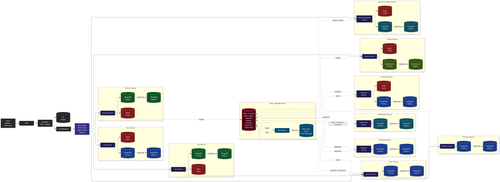

# High Level System Design (HLD)

A curated collection of scalable, production-ready High-Level System Designs (HLD), architecture diagrams, and capacity estimations.

---

## System Design Catalog

| System | Preview | Documentation | Diagram Source |
| :--- | :--- | :--- | :--- |
| **E-Commerce Microservices Platform** (Amazon / Flipkart scale) | [](designs/ecommerce/) | [Documentation & Spec](designs/ecommerce/README.md) | [`ecommerce-hld.mmd`](designs/ecommerce/ecommerce-hld.mmd) |

---

## Repository Structure

```text
HLD-design/
├── README.md                      # Main catalog and index of all system designs
├── images/                        # Exported high-resolution architecture images
│   ├── ecommerce-hld.png
│   └── ecommerce-architecture.jpg
└── designs/                       # Modular directory for each individual system design
    └── ecommerce/                 # E-Commerce Microservices HLD
        ├── README.md              # Detailed specifications, requirements & capacity
        └── ecommerce-hld.mmd      # Source Mermaid architecture diagram
```

---

## How Each System Design Is Structured

Every design in [`designs/`](designs/) includes:
- **Dedicated `README.md`**: Complete system breakdown, functional & non-functional requirements, and capacity planning.
- **Visual Architecture Image**: Rendered high-resolution diagram stored in `images/`.
- **Mermaid Source File (`.mmd`)**: Easily editable diagram source code for live previews and continuous updates.

---

## Contributing a New Design

To add a new system design:
1. Create a dedicated folder under `designs/<system-name>/`.
2. Add `README.md` with complete architecture documentation and requirements.
3. Place the `.mmd` diagram file in that folder and export a preview image into `images/`.
4. Add the entry to the [System Design Catalog](#system-design-catalog) table above.
