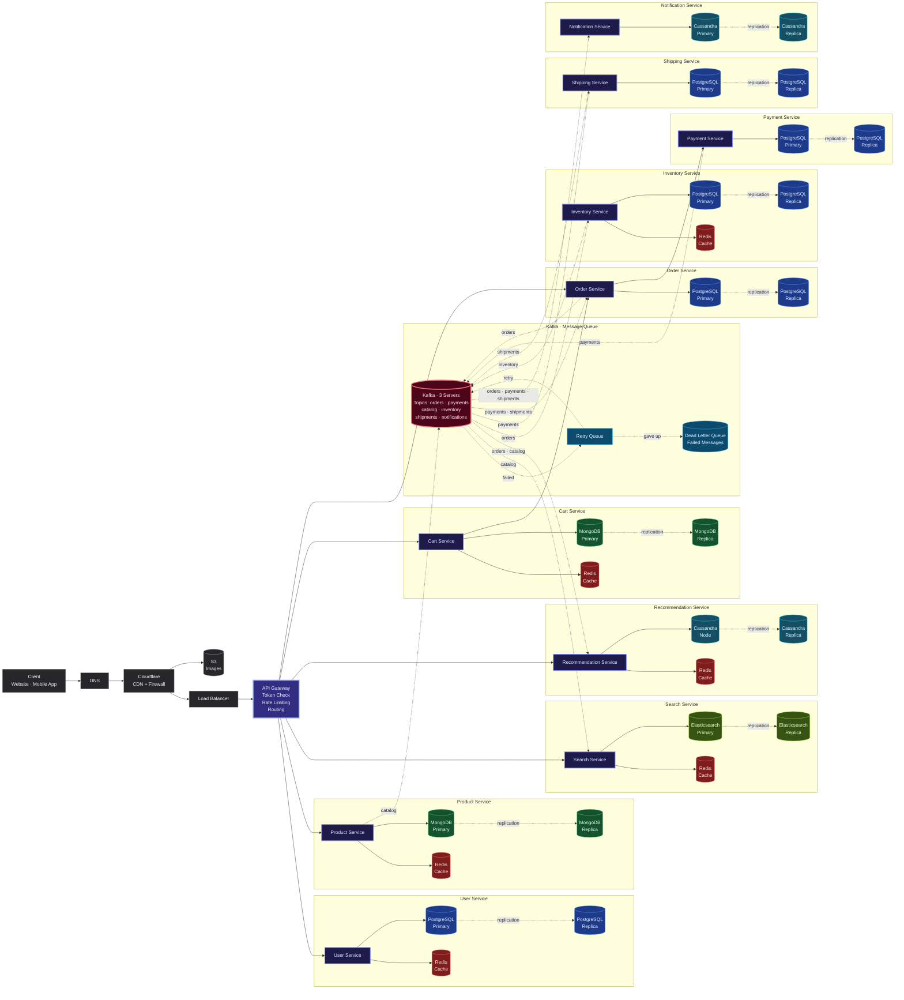

# High Level Design · E-Commerce Platform

Microservices architecture for an e-commerce platform like Amazon or Flipkart, designed for **1 Million daily active users**.

---

## Functional Requirements

*What the system should do:*

1. User can **sign up, log in, and manage profile**
2. User can **browse products** by category
3. User can **search products** with filters (price, rating, brand)
4. User gets **product recommendations** ("You might also like")
5. User can **add products to cart** and update quantities
6. User can **place an order** from cart
7. User can **make payment** (UPI, card, net banking)
8. User can **track order status** (placed → shipped → delivered)
9. User receives **email and SMS notifications** (order confirmation, shipping update)
10. Admin can **add, update, delete products** and manage inventory

---

## Non-Functional Requirements

*How well the system should perform:*

| Requirement | Target |
| --- | --- |
| **Response Time** | < 200ms for product pages, < 500ms for search |
| **Availability** | 99.9% uptime (max ~8 hours downtime per year) |
| **Scalability** | Handle 1M+ daily active users, scale up during sales |
| **Throughput** | ~120 requests/second normal, ~1200 requests/second peak |
| **Data Consistency** | Orders and payments must never be lost or duplicated |
| **Fault Tolerance** | If one service goes down, others keep working |
| **Security** | All data encrypted, token-based authentication |

---

## Capacity Estimation · 1 Million Users

### Traffic

| Metric | Calculation | Result |
| --- | --- | --- |
| Daily Active Users | — | 1,000,000 |
| Requests per user per day | ~10 pages per session | 10,000,000 requests/day |
| Requests per second (average) | 10M ÷ 86,400 | **~120 requests/sec** |
| Peak traffic (3x average) | 120 × 3 | **~360 requests/sec** |
| Flash sale peak (10x average) | 120 × 10 | **~1,200 requests/sec** |

### Storage

| Data | Calculation | Result |
| --- | --- | --- |
| User profiles | 1M users × 2 KB each | **2 GB** |
| Product catalog | 500K products × 5 KB each | **2.5 GB** |
| Product images | 500K products × 5 images × 500 KB | **1.25 TB** |
| Orders per year | 50K orders/day × 3 KB × 365 days | **55 GB/year** |
| Cart data | 200K active carts × 1 KB | **200 MB** |

### Bandwidth

| Direction | Calculation | Result |
| --- | --- | --- |
| Incoming (user requests) | 120 req/sec × 2 KB each | **240 KB/sec** |
| Outgoing (product pages + images) | 120 req/sec × 500 KB each | **60 MB/sec** |

---

## How the Diagram Arrows Work

| Arrow Type | Meaning | Example |
| --- | --- | --- |
| **Solid line** `──────→` | User is waiting for a response. The request goes and comes back before anything else happens. | User clicks "Place Order" → Order Service creates order → User sees "Order Placed" |
| **Dotted line** `- - - →` | Happens in background. The user doesn't wait. One service puts a message in Kafka, another picks it up later. | Order placed → Kafka message → Inventory Service reserves stock (user doesn't wait for this) |
| **Dotted "replication"** | Database copies its data to a backup server. If the main server dies, the backup takes over. | PostgreSQL Primary → PostgreSQL Replica |

---

## Architecture Diagram

---

## Step-by-Step: What Happens When a User Places an Order

| Step | What Happens | Who Does It |
| --- | --- | --- |
| 1 | User opens the website | Client |
| 2 | Request goes through DNS → Cloudflare → Load Balancer → API Gateway | Edge layer |
| 3 | API Gateway checks if the user's token is valid | API Gateway |
| 4 | User browses products — data comes from Redis cache (fast) or MongoDB (if not cached) | Product Service |
| 5 | User searches "laptop" — Elasticsearch finds matching products | Search Service |
| 6 | User sees "You might also like" — based on past browsing | Recommendation Service |
| 7 | User adds a laptop to cart — saved in Redis for fast access, backed up in MongoDB | Cart Service |
| 8 | User clicks "Place Order" — Order Service creates the order in PostgreSQL | Order Service |
| 9 | Order Service calls Payment Service — payment is charged | Payment Service |
| 10 | Order Service puts a message on Kafka `orders` topic | Kafka |
| 11 | Inventory Service picks up the message and reserves stock | Inventory Service |
| 12 | Payment Service puts a message on Kafka `payments` topic | Kafka |
| 13 | Shipping Service picks it up and creates a shipment | Shipping Service |
| 14 | Notification Service sends email and SMS to the user | Notification Service |
| 15 | User sees "Order Placed Successfully" on screen | Client |

---

## What Each Service Does

| Service | What It Does | Database |
| --- | --- | --- |
| **User Service** | Sign up, login, manage profiles | PostgreSQL + Redis |
| **Product Service** | Product catalog — names, prices, images | MongoDB + Redis |
| **Search Service** | Search products, filters, autocomplete | Elasticsearch + Redis |
| **Recommendation Service** | "You might also like" suggestions | Cassandra + Redis |
| **Cart Service** | Add to cart, update quantities | MongoDB + Redis |
| **Order Service** | Create orders, track order status | PostgreSQL |
| **Payment Service** | Process payments, handle refunds | PostgreSQL |
| **Inventory Service** | Track stock, reserve on order | PostgreSQL + Redis |
| **Shipping Service** | Create shipments, track delivery | PostgreSQL |
| **Notification Service** | Send updates via email and SMS | Cassandra |

---

## How Kafka Connects Services

When Order Service creates an order, it puts a message in Kafka. Other services pick it up in the background. The user doesn't wait.

| Topic | Who Sends | Who Receives |
| --- | --- | --- |
| `orders` | Order Service | Inventory, Recommendation, Notification |
| `payments` | Payment Service | Shipping, Order, Notification |
| `catalog` | Product Service | Search, Recommendation |
| `inventory` | Inventory Service | — |
| `shipments` | Shipping Service | Order, Notification |

**3 Kafka Servers** — every message is copied to all 3. If one dies, the other two still have the data.

---

## Dead Letter Queue

When a message fails:

1. **Fails** → goes to Retry Queue
2. **Retry Queue** tries again
3. **If all retries fail** → goes to Dead Letter Queue
4. **Dead Letter Queue** stores it so engineers can fix the issue and replay it

No message is ever lost.

---

## Color Guide

| Color | What It Means |
| --- | --- |
| 🟣 Purple | Services |
| 🔵 Blue | PostgreSQL |
| 🟢 Green | MongoDB |
| 🔴 Red | Redis Cache |
| 🩵 Cyan | Cassandra |
| 🟡 Yellow-Green | Elasticsearch |
| 🩷 Pink | Kafka |
| ⬜ Gray | Client, DNS, Cloudflare, Load Balancer |
