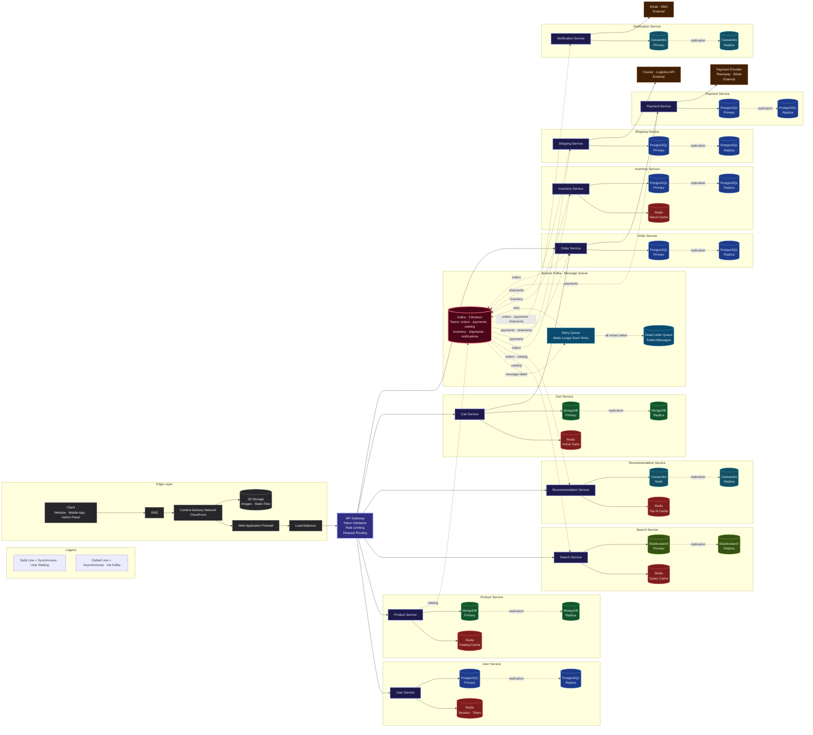

# High Level Design · E-Commerce Platform

Scalable microservices architecture for an e-commerce platform like Amazon or Flipkart.

---

## How It Works

A customer opens the app, browses products, adds items to cart, places an order, makes payment, and receives the product. Behind the scenes, 10 independent services handle each part of this journey, talking to each other through Apache Kafka so no service blocks another.

> **Solid lines** = Synchronous — the user is waiting for a response
>
> **Dotted lines** = Asynchronous — happens in the background via Kafka

---

## Architecture Diagram

---

## What Each Service Does

| Service | What It Does | Database | Why This Database |
| --- | --- | --- | --- |
| **User Service** | Sign up, login, manage profiles, sessions | PostgreSQL + Redis | Reliable user data + fast session lookups |
| **Product Service** | Product catalog — names, prices, images, variants | MongoDB + Redis | Flexible product schemas + hot product cache |
| **Search Service** | Full-text product search, filters, autocomplete | Elasticsearch + Redis | Built for fast text search + frequent query cache |
| **Recommendation Service** | "You might also like" suggestions | Cassandra + Redis | Handles massive click-tracking writes + top-N cache |
| **Cart Service** | Add to cart, update quantities, persist across devices | MongoDB + Redis | Flexible cart structure + active cart quick access |
| **Order Service** | Create orders, track status, coordinate the order flow | PostgreSQL | Orders must never be inconsistent |
| **Payment Service** | Process payments, handle refunds | PostgreSQL | Money transactions need strong consistency |
| **Inventory Service** | Track stock, reserve on order, release on cancellation | PostgreSQL + Redis | Accurate counts + real-time stock display |
| **Shipping Service** | Create shipments, generate tracking, update delivery status | PostgreSQL | Reliable shipment records |
| **Notification Service** | Send order confirmations, receipts, shipping updates | Cassandra | High-volume notification logs |

---

## How Kafka Connects Everything

When the Order Service creates a new order, it doesn't call the Inventory Service directly. Instead it puts a message on the `orders` topic. The Inventory Service picks it up when it's ready. No service blocks another.

| Topic | Who Sends | Who Receives |
| --- | --- | --- |
| `orders` | Order Service | Inventory, Recommendation, Notification |
| `payments` | Payment Service | Shipping, Order, Notification |
| `catalog` | Product Service | Search, Recommendation |
| `inventory` | Inventory Service | *(future consumers)* |
| `shipments` | Shipping Service | Order, Notification |

**3 Kafka Brokers** — every message is copied to all 3 servers. If one dies, the other two still have the data.

---

## Dead Letter Queue

When a message fails, it doesn't disappear:

1. **First attempt fails** → goes to the Retry Queue
2. **Retry Queue** waits longer each time and sends it back
3. **After all retries fail** → moves to Dead Letter Queue
4. **Dead Letter Queue** stores it permanently for engineers to review and fix

**No message is ever lost.**

---

## How an Order Is Placed (Step by Step)

| Step | What Happens | If It Fails |
| --- | --- | --- |
| 1 | User clicks "Place Order" → Order Service creates order | — |
| 2 | Kafka tells Inventory Service → stock reserved | Cancel order |
| 3 | Order Service calls Payment Service → payment charged | Release stock |
| 4 | Kafka tells Shipping Service → shipment created | Refund payment + release stock |
| 5 | Kafka tells Notification Service → email and SMS sent | Log failure, retry later |

If any step fails, all previous steps are undone automatically.

---

## Color Guide

| Color | What It Represents |
| --- | --- |
| 🟣 Purple | Microservices |
| 🔵 Blue | PostgreSQL databases |
| 🟢 Green | MongoDB databases |
| 🔴 Red | Redis caches |
| 🩵 Cyan | Cassandra databases |
| 🟡 Yellow-Green | Elasticsearch |
| 🟠 Orange (dashed border) | External services |
| 🩷 Pink | Apache Kafka |
| ⬜ Gray | Edge layer |
