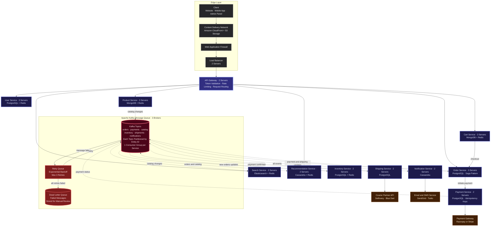

# HLD-design

High-Level Design for a scalable e-commerce platform built with microservices.

---

## E-Commerce Microservices Architecture

A user places an order on the website. The request travels through the edge layer, hits the API Gateway, reaches the right service, processes the order, takes payment, reserves inventory, ships the product, and sends notifications — all handled by independent services talking to each other through Apache Kafka.

> **Solid arrows** = Synchronous (user is waiting for a response)
>
> **Dotted arrows** = Asynchronous (happens in the background through Kafka)

### Architecture Diagram

---

### What Each Service Does

| Service | What It Does | Servers | Database | Why This Database |
| --- | --- | --- | --- | --- |
| **User Service** | Sign up, log in, manage profiles, store sessions | 3 | PostgreSQL + Redis | PostgreSQL for reliable user data, Redis for fast session lookups |
| **Product Service** | Store and manage product catalog (name, price, images, variants) | 3 | MongoDB + Redis | MongoDB handles flexible product schemas (different categories have different fields), Redis caches hot products |
| **Search Service** | Full-text search across products, filters, autocomplete | 2 | Elasticsearch + Redis | Elasticsearch is built for fast text search, Redis caches frequent queries |
| **Recommendation Service** | "You might also like" suggestions based on browsing and purchase history | 2 | Cassandra + Redis | Cassandra handles massive writes (every click is tracked), Redis caches top recommendations |
| **Cart Service** | Add to cart, update quantities, save cart across devices | 3 | MongoDB + Redis | MongoDB for flexible cart structure, Redis for active cart quick access |
| **Order Service** | Create orders, track status, coordinate the entire order flow using the Saga Pattern | 3 | PostgreSQL | PostgreSQL for strong ACID transactions — orders must never be inconsistent |
| **Payment Service** | Process payments, handle refunds, prevent duplicate charges with idempotency keys | 2 | PostgreSQL | PostgreSQL for reliable payment records — money transactions need strong consistency |
| **Inventory Service** | Track stock levels, reserve stock when order is placed, release stock on cancellation | 2 | PostgreSQL + Redis | PostgreSQL for accurate counts, Redis for real-time stock display |
| **Shipping Service** | Create shipments, generate tracking numbers, update delivery status | 2 | PostgreSQL | PostgreSQL for reliable shipment records |
| **Notification Service** | Send order confirmations, payment receipts, shipping updates via email and SMS | 2 | Cassandra | Cassandra handles high-volume write-heavy notification logs |

**Total: 24 service servers + 2 API Gateway servers + 2 Load Balancers = 28 servers minimum**

---

### How Apache Kafka Works Here

Kafka is the message queue that lets services talk to each other **without waiting**. When the Order Service creates a new order, it doesn't call the Inventory Service directly. Instead, it puts a message on the Kafka `orders` topic, and the Inventory Service picks it up whenever it's ready.

**Why 3 Brokers?** Each message is copied to all 3 Kafka broker servers. If one server dies, the other two still have the data. This is called a replication factor of 3.

**Kafka Topics and Who Uses Them:**

| Topic | Who Produces (Sends) | Who Consumes (Receives) |
| --- | --- | --- |
| `orders` | Order Service | Inventory Service, Recommendation Service, Notification Service |
| `payments` | Payment Service | Shipping Service, Order Service, Notification Service |
| `catalog` | Product Service | Search Service, Recommendation Service |
| `inventory` | Inventory Service | *(available for future consumers)* |
| `shipments` | Shipping Service | Order Service, Notification Service |

---

### How the Dead Letter Queue Works

When a message fails to process, it doesn't just disappear:

1. **First attempt fails** → Message goes to the Retry Queue
2. **Retry Queue** waits (1 second, then 5 seconds, then 30 seconds — exponential backoff) and sends it back to Kafka
3. **After 3 failed retries** → Message moves to the Dead Letter Queue
4. **Dead Letter Queue** stores the failed message permanently so engineers can review it, fix the bug, and replay the message manually

This ensures **no message is ever lost**, even when things go wrong.

---

### How the Saga Pattern Works (Order Service)

Placing an order involves multiple services (payment, inventory, shipping). If any step fails, we need to undo everything. The Order Service acts as the orchestrator:

1. **Create Order** → Order Service writes order to its database
2. **Reserve Inventory** → Kafka message to Inventory Service → stock reserved
3. **Process Payment** → Sync call to Payment Service → payment charged
4. **If payment fails** → Kafka message to Inventory Service → stock released (compensation)
5. **If payment succeeds** → Kafka message to Shipping Service → shipment created
6. **If shipping fails** → refund payment + release stock (compensation)

This is called the **Saga Pattern** — each step has a compensating action to undo it if something fails later.

---

### External Services

| Service | Provider | Purpose |
| --- | --- | --- |
| Payment Gateway | Razorpay or Stripe | Process credit card, UPI, net banking payments |
| Courier Partner | Delhivery, Blue Dart | Pick up, ship, and deliver packages |
| Email Service | SendGrid | Send order confirmation and receipt emails |
| SMS Service | Twilio | Send order and shipping status via text message |
| Content Delivery Network | Amazon CloudFront | Serve product images and static files fast from edge locations closest to the user |
| Object Storage | Amazon S3 | Store product images, invoices, and other files |
