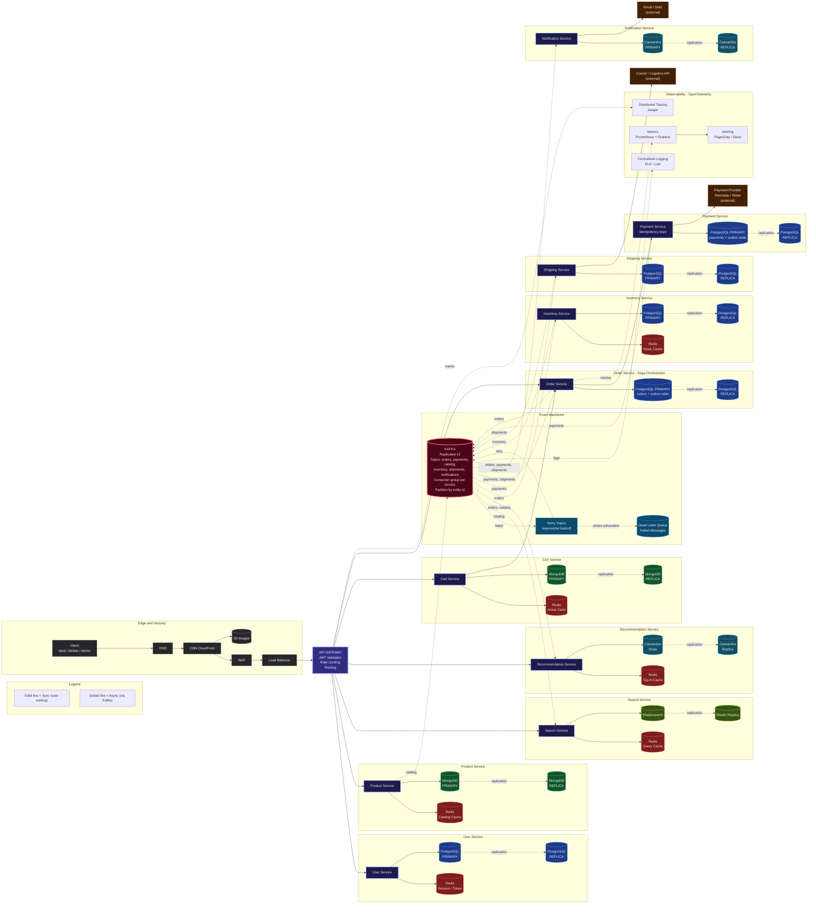

# HLD-design

High-Level Design (HLD) architecture diagrams and system design documentation.

## Architectures

| System | Diagram File | Key Concepts |
| --- | --- | --- |
| E-Commerce Microservices | [`ecommerce-hld-microservices.mmd`](./ecommerce-hld-microservices.mmd) | API Gateway, Saga Orchestrator, Outbox Pattern, Kafka Event Backbone, Polyglot Persistence, OpenTelemetry |

---

## E-Commerce Microservices HLD

Source diagram: [`ecommerce-hld-microservices.mmd`](./ecommerce-hld-microservices.mmd)

### Overview

This design models an event-driven e-commerce microservices architecture separating synchronous user-facing flows from asynchronous event-driven workflows.

- **Solid arrows (`-->`)**: Synchronous calls (user waiting)
- **Dotted arrows (`-.->`)**: Asynchronous communication via Kafka (and database replication / telemetry)

### Architecture Components

#### 1. Edge & Security
- **Traffic Path**: `Client (Web / Mobile / Admin)` → `DNS` → `CDN CloudFront` → `WAF` → `Load Balancer` → `API GATEWAY`
- **Static Assets**: `CDN CloudFront` serves images from `S3 Images`
- **API Gateway**: Handles JWT validation, rate limiting, and routing

#### 2. Microservices & Data Stores
- **User Service**: Redis (`Session / Token`), PostgreSQL (`PRIMARY` + `REPLICA`)
- **Product Service**: Redis (`Catalog Cache`), MongoDB (`PRIMARY` + `REPLICA`)
- **Search Service**: Redis (`Query Cache`), Elasticsearch (+ `Elastic Replica`)
- **Recommendation Service**: Redis (`Top-N Cache`), Cassandra (`Node` + `Replica`)
- **Cart Service**: Redis (`Active Carts`), MongoDB (`PRIMARY` + `REPLICA`)
- **Order Service (Saga Orchestrator)**: PostgreSQL (`PRIMARY` with `orders + outbox table`, + `REPLICA`)
- **Payment Service**: Idempotency keys, PostgreSQL (`PRIMARY` with `payments + outbox table`, + `REPLICA`), external `Payment Provider (Razorpay / Stripe)`
- **Inventory Service**: Redis (`Stock Cache`), PostgreSQL (`PRIMARY` + `REPLICA`)
- **Shipping Service**: PostgreSQL (`PRIMARY` + `REPLICA`), external `Courier / Logistics API`
- **Notification Service**: Cassandra (`PRIMARY` + `REPLICA`), external `Email / SMS`

#### 3. Event Backbone (Kafka)
- **Cluster**: Replicated x3 Kafka cluster partitioned by entity ID with a consumer group per service
- **Topics**: `orders`, `payments`, `catalog`, `inventory`, `shipments`, `notifications`
- **Resilience**: Failed messages route to `Retry Topics (exponential backoff)` and either retry back to Kafka or move to the `Dead Letter Queue (DLQ)` once retries are exhausted
- **Producers (Outbox Relay)**:
  - `Product Service` → `catalog`
  - `Order Service` → `orders`
  - `Payment Service` → `payments`
  - `Inventory Service` → `inventory`
  - `Shipping Service` → `shipments`
- **Consumers**:
  - `Search Service` ← `catalog`
  - `Recommendation Service` ← `orders`, `catalog`
  - `Inventory Service` ← `orders`
  - `Shipping Service` ← `payments`
  - `Order Service` ← `payments`, `shipments`
  - `Notification Service` ← `orders`, `payments`, `shipments`

#### 4. Synchronous Flows
- `API GATEWAY` → `User Service`, `Product Service`, `Search Service`, `Recommendation Service`, `Cart Service`, `Order Service`
- `Cart Service` → `Order Service`
- `Order Service` → `Payment Service`

#### 5. Observability (OpenTelemetry)
- **Centralized Logging**: ELK / Loki (logs from Kafka)
- **Metrics & Alerting**: Prometheus + Grafana (metrics from Order Service) → PagerDuty / Slack
- **Distributed Tracing**: Jaeger (traces from API Gateway)

### Diagram

