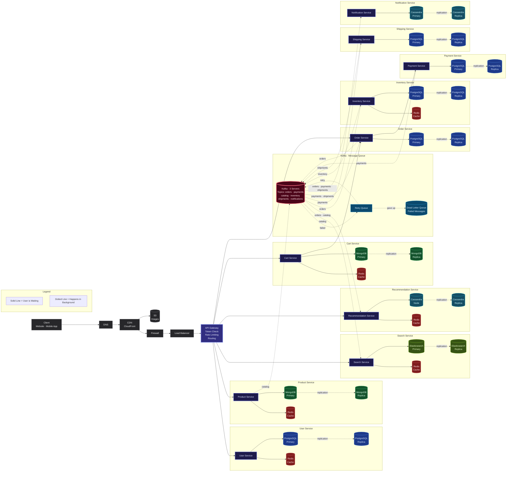

# High Level Design · E-Commerce Platform

Microservices architecture for an e-commerce platform like Amazon or Flipkart.

---

## How It Works

A customer opens the app, browses products, adds items to cart, places an order, makes payment, and receives the product. 10 independent services handle each part, talking to each other through Kafka so no service blocks another.

> **Solid lines** = User is waiting for a response
>
> **Dotted lines** = Happens in background through Kafka

---

## Architecture Diagram

---

## What Each Service Does

| Service | What It Does | Database |
| --- | --- | --- |
| **User Service** | Sign up, login, manage profiles | PostgreSQL + Redis |
| **Product Service** | Product catalog — names, prices, images | MongoDB + Redis |
| **Search Service** | Search products, filters, autocomplete | Elasticsearch + Redis |
| **Recommendation Service** | "You might also like" suggestions | Cassandra + Redis |
| **Cart Service** | Add to cart, update quantities | MongoDB + Redis |
| **Order Service** | Create orders, track order status | PostgreSQL |
| **Payment Service** | Process payments, handle refunds | PostgreSQL |
| **Inventory Service** | Track stock, reserve on order | PostgreSQL + Redis |
| **Shipping Service** | Create shipments, track delivery | PostgreSQL |
| **Notification Service** | Send order and shipping updates via email and SMS | Cassandra |

---

## How Kafka Connects Services

When Order Service creates a new order, it puts a message on the `orders` topic. Inventory Service picks it up when ready. No service blocks another.

| Topic | Who Sends | Who Receives |
| --- | --- | --- |
| `orders` | Order Service | Inventory, Recommendation, Notification |
| `payments` | Payment Service | Shipping, Order, Notification |
| `catalog` | Product Service | Search, Recommendation |
| `inventory` | Inventory Service | — |
| `shipments` | Shipping Service | Order, Notification |

**3 Kafka Servers** — every message is copied to all 3. If one dies, the other two still have the data.

---

## Dead Letter Queue

When a message fails:

1. **Fails** → goes to Retry Queue
2. **Retry Queue** tries again
3. **If all retries fail** → goes to Dead Letter Queue
4. **Dead Letter Queue** stores it so engineers can fix the issue and replay it

No message is ever lost.

---

## Color Guide

| Color | What It Means |
| --- | --- |
| 🟣 Purple | Services |
| 🔵 Blue | PostgreSQL |
| 🟢 Green | MongoDB |
| 🔴 Red | Redis Cache |
| 🩵 Cyan | Cassandra |
| 🟡 Yellow-Green | Elasticsearch |
| 🩷 Pink | Kafka |
| ⬜ Gray | Client, DNS, CDN, Firewall, Load Balancer |
