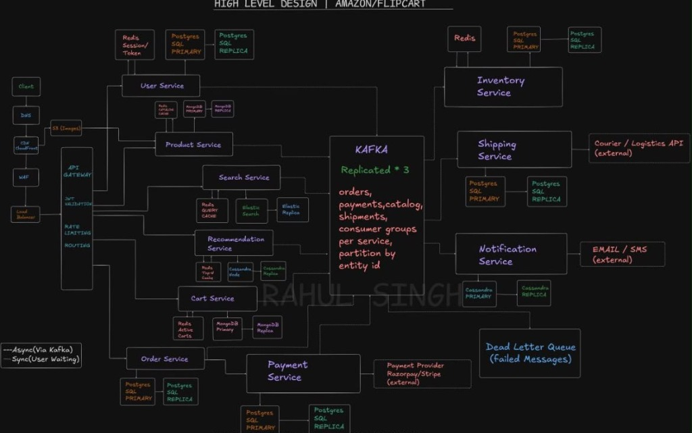
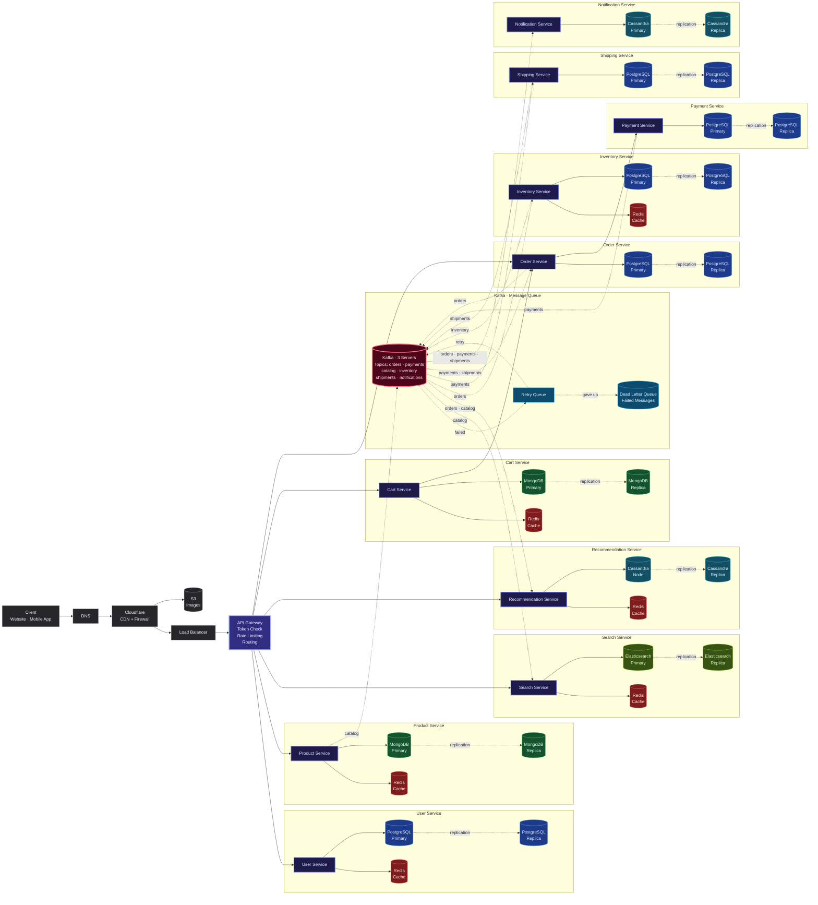

# E-Commerce Platform · High Level Design (HLD)

Comprehensive microservices architecture for an e-commerce platform (like Amazon or Flipkart), designed to support **1 Million daily active users**.

---

## Architecture Diagram

> **Source File**: [`ecommerce-hld.mmd`](./ecommerce-hld.mmd)

---

## Functional Requirements

1. **User Authentication & Profiles**: Sign up, log in, session handling, profile updates.
2. **Product Catalog**: Browse categories, view product details, pricing, variants, and stock.
3. **Search & Discovery**: Full-text keyword search with filters (category, price, ratings, brand) and autocomplete.
4. **Recommendations**: Personalized product suggestions ("You might also like") based on browsing history.
5. **Shopping Cart**: Add/remove items, adjust quantities, sync cart across devices.
6. **Order Placement**: Place orders from cart, generate invoice, calculate totals.
7. **Payment Processing**: Handle payments (UPI, credit/debit card, net banking), handle refunds.
8. **Inventory Management**: Track stock levels in real time, reserve stock on order placement, release stock on cancellation.
9. **Shipping & Fulfillment**: Generate tracking numbers, update delivery status (placed → packed → shipped → delivered).
10. **Notifications**: Send real-time updates via Email and SMS on key order lifecycle events.

---

## Non-Functional Requirements

| Metric | Target | Rationale |
| --- | --- | --- |
| **Latency** | < 200ms page load, < 500ms search | Keeps customer drop-off low |
| **Availability** | 99.9% uptime | Critical for revenue; downtime loses sales |
| **Scalability** | 1M+ DAU | Ability to auto-scale horizontally during sales events |
| **Throughput** | ~120 req/s normal, ~1,200 req/s peak | Accommodates 10x spikes during peak flash sales |
| **Data Consistency** | Strong consistency for payments/orders | Zero tolerance for duplicate charges or overselling |
| **Fault Isolation** | Resilient decoupled microservices | If recommendation or notification fails, checkout still succeeds |
| **Security** | HTTPS, Cloudflare WAF, Token auth | Protect customer payment details and user data |

---

## Capacity Estimation (1 Million Users)

### Traffic Estimation
- **Daily Active Users (DAU)**: 1,000,000 users/day
- **Average Requests / User**: ~10 interactions/day = 10,000,000 requests/day
- **Average QPS**: $10,000,000 \div 86,400 \approx$ **120 requests/second**
- **Peak Traffic (3x)**: **~360 requests/second**
- **Flash Sale Spike (10x)**: **~1,200 requests/second**

### Storage Estimation
- **User Records**: $1\text{M} \times 2\text{ KB} =$ **2 GB**
- **Product Catalog**: $500\text{K products} \times 5\text{ KB} =$ **2.5 GB**
- **Product Images (S3)**: $500\text{K products} \times 5\text{ images} \times 500\text{ KB} =$ **1.25 TB**
- **Orders (PostgreSQL)**: $50\text{K orders/day} \times 3\text{ KB} \times 365\text{ days} =$ **~55 GB/year**
- **Active Carts (Redis)**: $200\text{K active carts} \times 1\text{ KB} =$ **200 MB**

---

## How the Diagram Arrows Work

| Arrow Type | Flow Type | Meaning |
| --- | --- | --- |
| **Solid line** `──────→` | **Synchronous** | The user is actively waiting for an immediate response (e.g., Client → API Gateway → Order Service). |
| **Dotted line** `- - - →` | **Asynchronous** | Happens in the background via Apache Kafka without blocking the user (e.g., Order Service → Kafka → Inventory Service). |
| **Dotted "replication"** | **Data Sync** | Database primary continuously streams updates to read replicas for failover and read scaling. |

---

## Interactive Mermaid Diagram

---

## Step-by-Step Order Lifecycle

1. **User Request**: User connects via DNS → Cloudflare CDN/WAF → Load Balancer → API Gateway.
2. **Auth Verification**: API Gateway verifies JWT token and enforces rate limits.
3. **Product Exploration**: Product data is fetched instantly from Redis cache (or MongoDB if cache miss).
4. **Search Queries**: Elasticsearch delivers fast full-text filtering and autocomplete.
5. **Recommendations**: Cassandra tracks user activities to generate "You might also like" feeds.
6. **Cart Management**: Cart updates write to Redis for zero latency, backed up in MongoDB.
7. **Order Creation**: User clicks "Place Order"; Cart Service triggers Order Service to write an order record in PostgreSQL.
8. **Payment Handling**: Order Service calls Payment Service synchronously to charge the payment.
9. **Event Publishing**: Order Service publishes a message to the Kafka `orders` topic.
10. **Inventory Reservation**: Inventory Service consumes `orders` and decrements stock.
11. **Shipment Creation**: Payment Service publishes to `payments` topic; Shipping Service consumes it and generates tracking.
12. **Notifications**: Notification Service listens to Kafka topics and sends Email/SMS updates.
13. **Order Confirmation**: Customer receives instant confirmation on screen.

---

## Microservices Breakdown

| Service | Primary Responsibility | Storage / Cache | Key Reasoning |
| --- | --- | --- | --- |
| **User Service** | User profiles, authentication | PostgreSQL + Redis | ACID compliance for credentials; Redis for sessions |
| **Product Service** | Product catalog and metadata | MongoDB + Redis | Schema flexibility for varied product categories |
| **Search Service** | Catalog search and filtering | Elasticsearch + Redis | Inverted index for fast full-text queries |
| **Recommendation** | Personalized product feeds | Cassandra + Redis | High write-throughput for browsing signals |
| **Cart Service** | Cart state management | MongoDB + Redis | Fast read/write in Redis; persistent cart in Mongo |
| **Order Service** | Order creation & lifecycle | PostgreSQL | Strict ACID consistency for financial order records |
| **Payment Service** | Payment authorization & refunds | PostgreSQL | Strong transactional consistency for balance & logs |
| **Inventory Service** | Real-time stock counting | PostgreSQL + Redis | Strict counters to prevent overselling |
| **Shipping Service** | Dispatch & tracking updates | PostgreSQL | Reliable relational shipment records |
| **Notification Service** | Customer notifications (SMS/Email) | Cassandra | High append volume for notification history |

---

## Message Queue & Dead Letter Queue

Apache Kafka acts as the distributed event backbone:
- **Topics**: `orders`, `payments`, `catalog`, `inventory`, `shipments`, `notifications`
- **Replication Factor**: 3 brokers ensure high availability with zero data loss if one node fails.
- **Retry Mechanism**: Failed events route to a **Retry Queue** for transient error recovery.
- **Dead Letter Queue (DLQ)**: If retries are exhausted, events are moved to the DLQ for manual inspection and replay.
